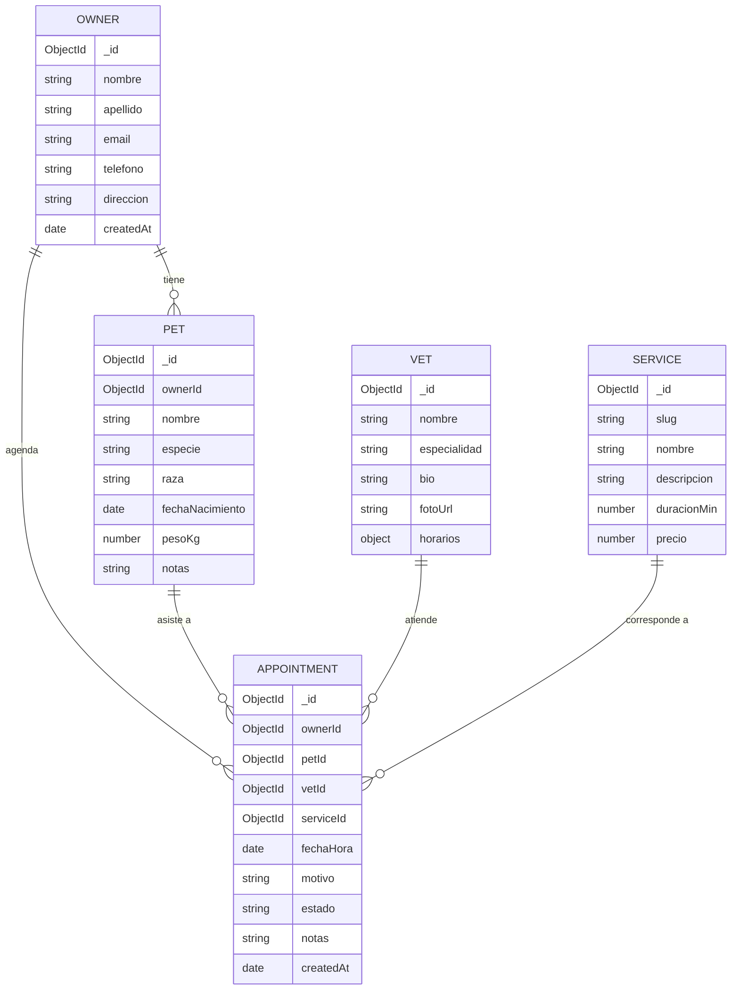
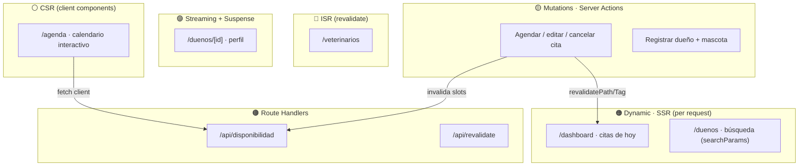

# 🐾 Lab Next.js — Estrategias de Renderizado

## Sistema de Agenda de Visitas Veterinarias · *personas · mascotas · citas*

---

## 0. Contexto y objetivos

Vas a construir el frontend + capa de datos de una **clínica veterinaria** que gestiona dueños, sus mascotas y las citas entre ambos. No es una app cualquiera: **cada feature está diseñada para forzarte a usar una estrategia de renderizado específica de Next**. La gracia del lab es que, al terminar, tengas un mapa mental claro de *cuándo* conviene cada una y *cómo* se comporta cada capa de cache.

Al terminar vas a poder:

- Distinguir en la práctica **Static (SSG)**, **Dynamic (SSR)**, **ISR**, **CSR**, **Streaming + Suspense**, **Server Actions**, **Route Handlers** y (bonus) **PPR**, **Parallel/Intercepting Routes** y el modelo de **caching** de Next.
- Leer el output de `next build` y saber por qué una ruta salió `○ Static`, `ƒ Dynamic` o ISR.
- Diseñar un sistema de estilos **100% CSS Modules** sobre una base de **design tokens** globales, sin frameworks de CSS ni CSS-in-JS.
- Modelar acceso a MongoDB del lado server sin filtrar el cliente al bundle del browser.

---


## 1. El dominio


### 1.1 Letra general del sistema

**VetLab** es la **consola operativa interna** del equipo de una clínica veterinaria de barrio (recepción y veterinarios): **los turnos los da de alta el staff** (por teléfono, mostrador o walk-in). Su objetivo central es simple de enunciar y rico en consecuencias: **coordinar el encuentro entre una mascota, su dueño y un veterinario, para un servicio puntual, en una fecha y hora, sin superposiciones, y conservando un historial coherente** de quién atendió qué y cuándo.

La clínica atiende con **agenda por veterinario**: cada profesional tiene sus horarios de atención y su especialidad, y los turnos se toman contra esa disponibilidad. Los servicios (consulta general, vacunación, cirugía, peluquería, control, ...) tienen una **duración** que determina cuánto ocupa cada turno en la agenda.

**Actores**

- **Recepción / staff** — el **usuario principal** del sistema: opera el día a día, da de alta turnos (por teléfono, mostrador o walk-in), confirma/completa/cancela, y registra dueños y mascotas nuevas.
- **Dueño y mascota** — **no** son usuarios del sistema (no hay login ni portal): son **registros** que el staff administra (contacto, mascotas e historial de citas).
- **Admin / veterinario** — mantiene el catálogo (vets y servicios), que cambia rara vez pero cuando cambia debe reflejarse rápido.

**Journeys principales**

1. **Operación diaria** (staff): dashboard con los turnos de hoy → gestionar estados en el momento → alta de walk-ins. Prioriza datos **frescos** y en tiempo casi real.
2. **Reserva de turno** (staff): elegir dueño/mascota/vet/servicio → ver la disponibilidad del vet → confirmar el turno contra esa agenda, sin superposiciones.
3. **Gestión de dueños** (staff): registrar dueño + su primera mascota → buscar dueños → abrir perfil e historial.
4. **Mantenimiento de catálogo** (admin): editar un vet o un servicio → el cambio se refleja en las vistas internas casi al instante.

**Alcance y supuestos** *(lo que te permite inferir el resto)*

- **Zona horaria única**: America/Montevideo. No hay multi-tz. Las fechas se guardan en UTC y se muestran en hora local.
- **Volumen modesto** (clínica de barrio): decenas de dueños/mascotas, turnos del orden de decenas por día. La paginación es básica; no hay que optimizar para millones de registros.
- **Ciclo de vida de la cita**: `pendiente` (recién creada) → `confirmada` → `completada`, o `cancelada` en cualquier punto previo. Una cita `cancelada` libera el slot; una `completada` es historia.
- **Identidad**: el lab **no** exige auth real. Asumí que la consola operativa es de uso interno (podés stubbear "el staff logueado"); construir login **no** es objetivo del lab. Si querés protegerla, es bonus.
- **Contacto como identidad**: a los dueños se los identifica por email/teléfono; el **email es único** por dueño.
- **Catálogo y precios** son de **referencia interna** (el staff los consulta al agendar); el lab **no procesa pagos**.
- **Fuera de alcance** (pero inferibles sin rediseñar): recordatorios/notificaciones previos al turno, manejo de *no-shows*, y reprogramación. El modelo está pensado para que puedas sumarlos como extensión natural (p. ej. un `estado` `"no_show"` o un campo de recordatorio).

> **Cómo usar esta letra:** cuando un requerimiento no especifique un detalle (validaciones exactas, textos, qué campos mostrar en una card, cómo ordenar una lista), **inferí la decisión razonable a partir de este contexto y de los modelos de 1.3**, y documentá el supuesto. La consigna fija la *estrategia de renderizado* obligatoria; el resto del producto lo completás vos con criterio.


### 1.2 Modelo de datos




### 1.3 Modelos de las entidades

Estos modelos son la **fuente de verdad** de las formas de datos. En la DB los ids son `ObjectId`; al cruzar al cliente (props Server→Client, respuestas de Route Handlers) se **serializan a** `string`. Definí ambos con alias para no mezclarlos.

```ts
// lib/models/shared.ts
import type { ObjectId } from "mongodb";

/** En DB: ObjectId. Serializado (cliente / JSON): string. */
export type Id = ObjectId;
export type IdString = string;

export type Especie =
  | "perro" | "gato" | "ave" | "roedor" | "reptil" | "otro";

export type EstadoCita =
  | "pendiente" | "confirmada" | "completada" | "cancelada";

export type DiaSemana =
  | "lun" | "mar" | "mie" | "jue" | "vie" | "sab" | "dom";

/** Tramo de atención dentro de un día, formato "HH:mm" en hora local. */
export interface FranjaHoraria { desde: string; hasta: string; }

/** Horarios de atención de un vet, por día de la semana. */
export type Horarios = Partial<Record<DiaSemana, FranjaHoraria[]>>;
```


#### Owner (`owners`)

```ts
export interface Owner {
  _id: Id;
  nombre: string;
  apellido: string;
  email: string;        // único
  telefono: string;
  direccion?: string;
  createdAt: Date;
}
```

- **Único:** `email`. **Índice de texto** sobre `nombre`, `apellido`, `email`, `telefono` para la búsqueda de R07.
- `createdAt` lo setea el server al crear; nunca lo manda el cliente.


#### Pet (`pets`)

```ts
export interface Pet {
  _id: Id;
  ownerId: Id;          // → Owner
  nombre: string;
  especie: Especie;
  raza?: string;
  fechaNacimiento?: Date;
  pesoKg?: number;
  notas?: string;
}
```

- **Índice:** `{ ownerId: 1 }` (traer las mascotas del dueño en el perfil, R08).
- Toda mascota tiene `ownerId` (regla dura, 1.5).


#### Vet (`vets`)

```ts
export interface Vet {
  _id: Id;
  nombre: string;
  especialidad: string;
  bio?: string;
  fotoUrl?: string;
  horarios: Horarios;   // define la disponibilidad base
}
```

- `horarios` acota la disponibilidad que se calcula en R14.
- Cambia rara vez → candidato natural a **ISR** (R04) con invalidación **on-demand** (R05).


#### Service (`services`)

```ts
export interface Service {
  _id: Id;
  slug: string;         // único · identificador legible (no hay ruta pública)
  nombre: string;
  descripcion: string;
  duracionMin: number;  // cuánto ocupa el turno en la agenda
  precio: number;       // informativo (el lab no cobra)
  activo?: boolean;     // default true
}
```

- **Único:** `slug`. Identificador legible/estable del servicio (útil como clave en selects y en URLs internas).
- `duracionMin` es la base del cálculo de solapamiento y de slots.


#### Appointment (`appointments`)

```ts
export interface Appointment {
  _id: Id;
  ownerId: Id;          // → Owner
  petId: Id;            // → Pet
  vetId: Id;            // → Vet
  serviceId: Id;        // → Service
  fechaHora: Date;      // inicio del turno (UTC en DB)
  motivo?: string;
  estado: EstadoCita;   // default "pendiente"
  notas?: string;
  createdAt: Date;
}
```

- **Índices:** `{ vetId: 1, fechaHora: 1 }` (solapamiento + disponibilidad, R11/R14); `{ fechaHora: 1 }` (dashboard del día, R06); opcional `{ ownerId: 1 }` (historial en el perfil).
- El turno ocupa el intervalo `[fechaHora, fechaHora + service.duracionMin)`. **Activa** = `estado !== "cancelada"`.


#### Tipos derivados (UI y APIs)

Te ahorran adivinar la forma de las respuestas de las features:

```ts
// Respuesta de GET /api/disponibilidad (R14)
export interface Slot {
  inicio: string;      // ISO
  fin: string;         // ISO
  disponible: boolean;
}

// Cita "populada" con sus refs, para dashboard / perfil (R06 / R08)
export interface AppointmentView
  extends Omit<Appointment, "ownerId" | "petId" | "vetId" | "serviceId"> {
  owner:   Pick<Owner, "_id" | "nombre" | "apellido">;
  pet:     Pick<Pet, "_id" | "nombre" | "especie">;
  vet:     Pick<Vet, "_id" | "nombre" | "especialidad">;
  service: Pick<Service, "_id" | "nombre" | "duracionMin">;
}

// Input de creación de cita: lo que manda el form (sin _id/createdAt, ids como string)
export type NewAppointmentInput = {
  ownerId: IdString;
  petId: IdString;
  vetId: IdString;
  serviceId: IdString;
  fechaHora: string;   // ISO en hora local → el server normaliza a UTC
  motivo?: string;
};
```

> Los índices de arriba no son opcionales para el lab: sin `{ vetId: 1, fechaHora: 1 }` el chequeo de solapamiento (R11) y el cálculo de disponibilidad (R14) escalan mal. Definilos en el seed o en el arranque de la app.


### 1.4 Entidades (colecciones)


| Colección      | Descripción                                                                          | Cambia...                  |
| -------------- | ------------------------------------------------------------------------------------ | -------------------------- |
| `owners`       | Personas dueñas de mascotas.                                                         | seguido (registros nuevos) |
| `pets`         | Mascotas, ligadas a un `ownerId`.                                                    | seguido                    |
| `vets`         | Veterinarios de la clínica: especialidad, bio, foto, `horarios` de atención.         | **rara vez**               |
| `services`     | Servicios ofrecidos (consulta, vacunación, cirugía, peluquería, ...). Tienen `slug`. | **rara vez**               |
| `appointments` | Citas: relacionan owner + pet + vet + service en una `fechaHora`, con `estado`.      | **constantemente**         |


> El ritmo de cambio de cada colección **no es decorativo**: es la pista de qué estrategia de renderizado le conviene a la feature que la consume.


### 1.5 Reglas de negocio

- `appointment.estado ∈ { "pendiente", "confirmada", "completada", "cancelada" }`.
- Una cita ocupa el tramo `[fechaHora, fechaHora + service.duracionMin]` en la agenda de ese `vetId`.
- **No pueden solaparse** dos citas activas (no canceladas) del mismo veterinario.
- La **disponibilidad** de un vet en un día = sus `horarios` de atención − los tramos ya ocupados por citas activas.
- Una mascota siempre pertenece a un dueño (`pet.ownerId` obligatorio).

---


## 2. Stack requerido

- **Next.js 16+** (App Router). Documentá la versión exacta que uses (algunos bonus piden canary).
- **TypeScript** en modo `strict`. Prohibido `any` (usá `unknown` + narrowing si hace falta).
- **MongoDB** (Atlas o local vía Docker). Driver oficial `mongodb` **o** Mongoose — elegí uno y sé consistente.
- **Estilos:** ver sección 3 (restricción dura).
- **Data fetching en cliente:** TanStack Query (React Query) **o** SWR, según lo pida el requerimiento.
- Linter + formatter configurados (ESLint + Prettier). Incluí un `README.md` con el paso a paso de setup y un `.env.example`.

---


## 3. Restricciones de estilos  ⚠️ *lectura obligatoria*

> Esta es una **restricción dura del lab** y parte de la rúbrica. Rompela y el entregable no aprueba, por más que el rendering esté perfecto.


### 3.1 Reglas

1. **Solo CSS Modules.** Toda regla de estilo vive en archivos `*.module.css` co-ubicados con su componente. Prohibido:
  - Tailwind / UnoCSS / cualquier utility framework.
  - CSS-in-JS (styled-components, emotion, `style={{}}` inline salvo para valores calculados dinámicamente en runtime — p. ej. la posición de un evento en el calendario).
  - Librerías de componentes con estilos propios (MUI, Chakra, etc.).
2. **Los estilos globales se definen con tokens.** Hay **un único** `globals.css` (importado en el root `layout`) que declara el sistema de **design tokens** como CSS custom properties en `:root`. Ese archivo global se limita a: reset/normalize mínimo, tokens, y estilos base de `html/body`. Nada de estilos de componentes ahí.
3. **Los CSS Modules NO hardcodean valores.** Colores, espaciados, radios, tipografías, sombras, etc. **siempre** se consumen vía `var(--token)`. Un `color: #12a594` hardcodeado en un module es una violación; lo correcto es `color: var(--color-primary-500)`.
4. **Bonus temático:** el sistema de tokens debe habilitar un **theme oscuro** conmutable con `[data-theme="dark"]` **sin tocar los CSS Modules** (solo redefiniendo tokens). Ver R-B (bonus de theming).


### 3.2 `globals.css` provisto (punto de partida)

Usá estos tokens como base (podés extenderlos, no reducirlos):

```css
/* app/globals.css  — ANDAMIAJE PROVISTO */
:root {
  /* ===== Color · Brand ===== */
  --color-primary-50:  #e6f7f4;
  --color-primary-100: #b9ebe3;
  --color-primary-300: #57c9b6;
  --color-primary-500: #12a594;   /* teal principal (vibra "salud") */
  --color-primary-600: #0e857a;
  --color-primary-700: #0b6960;
  --color-accent-500:  #f4a259;   /* naranja cálido para CTAs/acentos */

  /* ===== Color · Semantic ===== */
  --color-success: #2e9e5b;
  --color-warning: #d99a0b;
  --color-danger:  #d64545;
  --color-info:    #3b82f6;

  /* ===== Color · Neutrals / Surfaces ===== */
  --color-bg:        #f7faf9;
  --color-surface:   #ffffff;
  --color-border:    #e2e8e6;
  --color-text:      #1a2b28;
  --color-text-soft: #55635f;
  --color-text-mute: #8a9691;

  /* ===== Spacing (base 4px) ===== */
  --space-1: 0.25rem;  --space-2: 0.5rem;  --space-3: 0.75rem;
  --space-4: 1rem;     --space-5: 1.5rem;  --space-6: 2rem;
  --space-8: 3rem;     --space-10: 4rem;

  /* ===== Radii ===== */
  --radius-sm: 4px; --radius-md: 8px; --radius-lg: 16px; --radius-full: 999px;

  /* ===== Typography ===== */
  --font-sans: system-ui, -apple-system, "Segoe UI", Roboto, sans-serif;
  --font-mono: "JetBrains Mono", ui-monospace, monospace;
  --fs-xs: 0.75rem;  --fs-sm: 0.875rem; --fs-md: 1rem;
  --fs-lg: 1.25rem;  --fs-xl: 1.75rem;  --fs-2xl: 2.5rem;
  --lh-tight: 1.2;   --lh-base: 1.55;

  /* ===== Elevation ===== */
  --shadow-sm: 0 1px 2px rgba(16,40,36,.06);
  --shadow-md: 0 4px 12px rgba(16,40,36,.10);
  --shadow-lg: 0 12px 32px rgba(16,40,36,.14);

  /* ===== Layout & z-index ===== */
  --container-max: 1120px;
  --z-modal: 1000; --z-toast: 1100;

  /* ===== Motion ===== */
  --transition-fast: 120ms ease;
  --transition-base: 200ms ease;
}

[data-theme="dark"] {
  --color-bg:        #0f1615;
  --color-surface:   #16211f;
  --color-border:    #26332f;
  --color-text:      #eaf1ef;
  --color-text-soft: #a7b4b0;
  --color-text-mute: #6f7c78;
  /* la marca puede mantenerse o ajustarse a gusto */
}

* { box-sizing: border-box; }
html, body { margin: 0; padding: 0; }
body {
  background: var(--color-bg);
  color: var(--color-text);
  font-family: var(--font-sans);
  font-size: var(--fs-md);
  line-height: var(--lh-base);
}
```


### 3.3 Convención de CSS Modules

- Un module por componente: `Card.tsx` + `Card.module.css`.
- Clases en `camelCase` (`.appointmentCard`, `.slotFree`), importadas como `styles.appointmentCard`.
- Componé estados con clases separadas + `clsx`/template strings (`${styles.slot} ${isFree ? styles.slotFree : ''}`).

---


## 4. Mapa de rutas y estrategias




---


## 5. Requerimientos funcionales

> Cada card tiene: **Ruta**, **Estrategia obligatoria**, **Qué construir**, **Criterios de aceptación** (checklist), **Hints** y **Gotchas**. La estrategia obligatoria **no es negociable**: resolverlo con otra estrategia = no aprueba ese requerimiento.

---

> La numeración arranca en **R04** (IDs estables; `R01`–`R03` sin uso). El `Service` sigue siendo una entidad porque cada turno lo referencia por su `duracionMin`.


### 🔵 Track B — Incremental Static Regeneration (ISR)


#### R04 — Directorio de veterinarios (time-based)

- **Ruta:** `/veterinarios`
- **Estrategia obligatoria:** **ISR con revalidación por tiempo**.
- **Qué construir:** grid de veterinarios desde `vets` (foto, nombre, especialidad, bio corta). Los datos cambian rara vez → no hace falta pegarle a la DB en cada request, pero sí reflejar cambios "en un rato".
- **Criterios de aceptación:**
  - [ ] La página se prerenderiza y se sirve cacheada dentro del *window* de revalidación.
  - [ ] Pasado el `revalidate`, el siguiente request dispara regeneración en background y la subsiguiente respuesta trae datos frescos.
  - [ ] Configuraste el `revalidate` de forma explícita (segment config **o** en el `fetch`).
- **Hints:** `export const revalidate = 3600` a nivel de segmento, o `fetch(url, { next: { revalidate: 3600, tags: ['vets'] } })`. Taggeá para poder invalidar on-demand (R05). Verificá con `next build && next start` (en `dev` el cache se comporta distinto).
- **Gotchas:** si accidentalmente marcás la ruta como dynamic (una dynamic function suelta), el `revalidate` deja de aplicar como ISR.


#### R05 — Revalidación on-demand

- **Ruta:** Server Action **o** Route Handler `/api/revalidate`.
- **Estrategia obligatoria:** **On-demand revalidation** (`revalidateTag` / `revalidatePath`).
- **Qué construir:** un flujo "admin edita un veterinario/servicio" que, al persistir, **invalida** el cache de `/veterinarios` (o del tag `vets`) para que el cambio se vea **ya**, sin esperar el window de R04.
- **Criterios de aceptación:**
  - [ ] Editar un vet → la próxima carga de `/veterinarios` muestra el cambio sin esperar el `revalidate`.
  - [ ] Se usa `revalidateTag('vets')` **o** `revalidatePath('/veterinarios')`.
- **Hints:** para que `revalidateTag` funcione, los fetches consumidos por R04 deben estar **taggeados**. Llamá la revalidación dentro de la mutation, después del write.
- **Gotchas:** `revalidatePath` invalida el Full Route Cache de ese path; asegurate del scope (¿el path exacto? ¿layout vs page?).

---


### 🟠 Track C — Dynamic Rendering (SSR)


#### R06 — Dashboard de citas del día

- **Ruta:** `/dashboard`
- **Estrategia obligatoria:** **Dynamic Rendering (SSR)** — datos **frescos por request**, sin cache.
- **Qué construir:** listado de las citas **de hoy**, con filtro por fecha vía `searchParams` (`?date=YYYY-MM-DD`) y por `estado`; contadores por estado. Cada request refleja el estado real de la DB en ese instante.
- **Criterios de aceptación:**
  - [ ] `next build` marca la ruta como `ƒ (Dynamic)`.
  - [ ] Cada request consulta MongoDB (no hay stale).
  - [ ] Cambiar `?date=` cambia el resultado sin rebuild ni reload completo del cache.
- **Hints:** leer `searchParams` (async en Next 15+ → `const sp = await searchParams`), o usar `fetch(..., { cache: 'no-store' })`, o `export const dynamic = 'force-dynamic'`, cualquiera fuerza dynamic. Elegí el mecanismo y justificalo.
- **Gotchas:** si cacheás sin querer el fetch de citas, vas a ver citas viejas. En datos que mutan constantemente, `no-store` es tu amigo.


#### R07 — Búsqueda de dueños (searchParams como fuente de verdad)

- **Ruta:** `/duenos?q=...&page=...`
- **Estrategia obligatoria:** **SSR leyendo** `searchParams`.
- **Qué construir:** buscador de dueños por nombre/email/teléfono. Los resultados se renderizan en el server según la URL; incluí paginación por `searchParams`. La URL debe ser **compartible** y reproducir el mismo resultado.
- **Criterios de aceptación:**
  - [ ] El estado de la búsqueda vive **en la URL**, no en estado de cliente.
  - [ ] Renderiza server-side por request según `q`/`page`.
  - [ ] Pegar la URL en otra pestaña reproduce la misma vista.
- **Hints:** un `<form>` con method GET que escribe la query, **o** un input client que hace `router.push`. El `page` (server) lee `searchParams.q`. Sanitizá `q` antes de armar el regex de Mongo.
- **Gotchas:** si vas por el input client con `router.push`, aplicá **debounce**; y ojo con inyección en el regex (`$regex`).

---


### 🟣 Track D — Streaming + Suspense


#### R08 — Perfil del dueño con streaming

- **Ruta:** `/duenos/[id]`
- **Estrategia obligatoria:** **Streaming SSR con** `<Suspense>` + `loading.tsx`.
- **Qué construir:** header del dueño (datos rápidos) que aparece **de inmediato**, y **dos secciones "lentas"** que llegan streameadas e independientes: **"Mascotas"** y **"Historial de citas"**, cada una con su *skeleton*. Cada sección lenta es su propio async Server Component.
- **Criterios de aceptación:**
  - [ ] El shell + el header se ven **antes** que las secciones lentas.
  - [ ] Cada `<Suspense>` resuelve por separado (una sección no bloquea a la otra).
  - [ ] Existe un `loading.tsx` que cubre la navegación inicial a la ruta.
- **Hints:** separá cada sección lenta en un componente async propio y envolvela en `<Suspense fallback={<Skeleton/>}>`. Si tus queries son rápidas, simulá latencia para *ver* el streaming.
- **Gotchas:** si hacés **todos** los `await` en el componente `page` (en vez de dentro de los hijos con Suspense), **no hay streaming** — bloqueás la respuesta entera. El streaming vive en los *boundaries*.

---


### ⚪ Track E — Client-Side Rendering (CSR)


#### R09 — Agenda / calendario interactivo

- **Ruta:** `/agenda`
- **Estrategia obligatoria:** **Client Components (**`'use client'`**)** con interactividad client-side.
- **Qué construir:** un calendario interactivo (vista día/semana) con navegación de fechas, selección de slot y filtros (por vet, por estado) **sin recargar la página**. Al clickear un slot libre, se dispara el flujo de agendar (R11).
- **Criterios de aceptación:**
  - [ ] La interacción (cambiar vista, navegar fechas, filtrar) es 100% client-side.
  - [ ] El estado de UI vive en el cliente (`useState`/`useReducer`).
  - [ ] El server manda el HTML inicial, pero la interactividad no requiere round-trips de navegación.
- **Hints:** `'use client'` en el componente del calendario; los datos iniciales pueden venir por props desde un Server Component padre. Para posicionar eventos podés usar `style={{}}` inline calculado (excepción permitida en la sección 3).
- **Gotchas:** **no** importes tu data layer de Mongo dentro de un Client Component (filtrarías credenciales/driver al bundle). Consumí datos por Route Handler (R14) o por props desde el server.


#### R10 — Slots en vivo con React Query / SWR

- **Ruta:** dentro de `/agenda`.
- **Estrategia obligatoria:** **Client data fetching (CSR)** con **TanStack Query** o **SWR**.
- **Qué construir:** al cambiar de día/vet en el calendario, la **disponibilidad de horarios** se pide desde el cliente a `/api/disponibilidad` (R14), con estados de loading/error, refetch y cache client-side.
- **Criterios de aceptación:**
  - [ ] Cambiar de día/vet refetchea la disponibilidad.
  - [ ] Loading y error se muestran en la UI.
  - [ ] El cache del cliente evita refetch innecesario al volver a un día ya visto.
- **Hints:** `useQuery(['slots', vetId, date], fetcher)`; usá `keepPreviousData`/`placeholderData` para transición suave entre días. Definí `staleTime`.
- **Gotchas:** después de crear una cita (R11), **invalidá** la query de slots para que la disponibilidad se actualice.

---


### 🟡 Track F — Mutations (Server Actions)


#### R11 — Agendar cita

- **Estrategia obligatoria:** **Server Action** invocada desde el form de agendar.
- **Qué construir:** formulario (dueño, mascota, vet, servicio, fecha/hora, motivo) → la action **valida en el server** (campos + slot libre según reglas de 1.5) → inserta en `appointments` → `revalidatePath('/dashboard')` e invalida el tag de slots.
- **Criterios de aceptación:**
  - [ ] La mutación ocurre en una Server Action (`'use server'`), no en un Route Handler llamado desde el cliente.
  - [ ] Validación **server-side** (no confiar en el cliente).
  - [ ] Errores de validación vuelven al form y se muestran.
  - [ ] Tras crear, `/dashboard` y la disponibilidad reflejan la cita nueva.
- **Hints:** `useActionState` (ex `useFormState`) para manejar el estado/errores del form; `useFormStatus` para el pending del botón. Progressive enhancement: debería funcionar aún con JS deshabilitado.
- **Gotchas:** revalidá **disponibilidad en el server** justo antes de insertar (evitá la *race*: dos personas agendando el mismo slot). Manejá doble-submit.


#### R12 — Editar / cancelar cita con optimistic UI

- **Estrategia obligatoria:** **Server Actions +** `useOptimistic` (+ `useActionState`).
- **Qué construir:** cambiar el `estado` de una cita (confirmar / completar / cancelar) con **feedback inmediato** optimista; la action persiste y revalida; si falla, **rollback**.
- **Criterios de aceptación:**
  - [ ] La UI se actualiza al instante (optimista) y se reconcilia con el resultado real.
  - [ ] Ante error, la UI revierte al estado previo.
- **Hints:** `useOptimistic` para el estado local optimista; la action devuelve éxito/error.
- **Gotchas:** el estado optimista es efímero; sin manejo de error correcto, quedás mostrando algo que no persistió.


#### R13 — Registrar dueño + primera mascota

- **Estrategia obligatoria:** **Server Actions** (multi-entidad).
- **Qué construir:** flujo que crea un `owner` y su **primera** `pet` (con `ownerId`), valida ambos, y al terminar hace `redirect()` al perfil `/duenos/[id]`.
- **Criterios de aceptación:**
  - [ ] Se crean owner y pet consistentemente (pet ligada al owner recién creado).
  - [ ] Validación server-side de ambos.
  - [ ] Redirect al perfil al finalizar.
- **Hints:** creá owner → obtené `_id` → creá pet con ese `ownerId` → `redirect(...)`.
- **Gotchas:** `redirect()` **lanza una excepción** por diseño; no la captures dentro de un `try/catch` que trague el throw (llamalo fuera del try o re-lanzá).

---


### 🟤 Track G — Route Handlers & capa de datos


#### R14 — Route Handler de disponibilidad

- **Ruta:** `GET /api/disponibilidad?vetId=&date=`
- **Estrategia obligatoria:** **Route Handler**.
- **Qué construir:** endpoint que calcula los **slots libres** de un vet en una fecha (horarios del vet − citas activas ocupadas). Es consumido por R10.
- **Criterios de aceptación:**
  - [ ] Responde JSON con los slots disponibles.
  - [ ] Se comporta como dinámico (datos frescos): no cachea disponibilidad vieja.
- **Hints:** `export async function GET(req: NextRequest)`; leé params con `req.nextUrl.searchParams`. Los GET de Route Handlers **pueden** cachearse — forzá `no-store`/dynamic para datos frescos.
- **Gotchas:** definí explícitamente el caching del handler; un handler que devuelve disponibilidad stale rompe el flujo de agendar.


#### R15 — Capa de datos + conexión Mongo

- **Estrategia obligatoria:** **Data layer server-only** con conexión singleton + `cache()` de React donde aplique.
- **Qué construir:** una capa `lib/data/`* con funciones tipadas por entidad (`getOwnerById`, `getTodayAppointments`, `getAvailability`, ...) que usan una **única** instancia de `MongoClient` (ver andamiaje). Memoizá con `cache()` las queries repetidas dentro de un mismo render.
- **Criterios de aceptación:**
  - [ ] Una sola instancia de `MongoClient` (no se satura la pool en dev/HMR).
  - [ ] Funciones reutilizables y tipadas (sin `any`).
  - [ ] El data layer está blindado con `import 'server-only'` y **nunca** se importa desde un Client Component.
- **Hints:** patrón oficial con `global._mongoClientPromise` (abajo). `cache()` de React deduplica la misma query en un render (Request Memoization).
- **Gotchas:** importar el data layer desde el cliente rompe el build (o peor, filtra secretos). El paquete `server-only` te tira error de build si eso pasa — usalo.

---


### 🏅 Track H — Bonus (avanzado)


#### R16 — Partial Prerendering (PPR)

- **Ruta:** `/reservar` (o `/agenda`).
- **Estrategia obligatoria:** **Partial Prerendering** — shell estático + hueco dinámico.
- **Qué construir:** la página de reservar con **shell estático** (layout, info de la clínica, encabezados) servido al instante, y un **hueco dinámico** (disponibilidad de slots) que llega streameado dentro de un `<Suspense>`.
- **Criterios de aceptación:**
  - [ ] El shell estático se sirve inmediato; el contenido dinámico llega después.
  - [ ] PPR habilitado (`experimental.ppr` + `export const experimental_ppr = true`).
  - [ ] Documentás la versión de Next (probablemente canary).
- **Gotchas:** requiere flag/canary; dejalo aislado para no romper el resto del build.


#### R17 — Parallel + Intercepting Routes (modal de cita)

- **Ruta:** slot `@modal` + `(.)cita/[id]` sobre `/agenda`.
- **Estrategia obligatoria:** **Parallel Routes + Intercepting Routes**.
- **Qué construir:** clickear una cita en la agenda abre su detalle en un **modal** encima de la agenda (sin perder el contexto); si el usuario **refresca** en esa URL, ve la **página completa** `/cita/[id]`.
- **Criterios de aceptación:**
  - [ ] Navegación soft → modal; hard refresh / deep link → página full.
  - [ ] Slot `@modal` con su `default.tsx`.
- **Hints:** convención `(.)` para interceptar el mismo nivel; cerrar el modal con `router.back()`.
- **Gotchas:** olvidarte del `default.tsx` del slot paralelo rompe el render cuando el slot no matchea.


#### R18 — Dynamic Metadata

- **Ruta:** `/duenos/[id]` (y cualquier otra ruta de detalle con dato dinámico).
- **Estrategia obligatoria:** `generateMetadata` con datos dinámicos.
- **Qué construir:** títulos/descripciones según el dato real (ej. `Historia de {mascota} · VetLab`).
- **Gotchas:** `generateMetadata` que usa datos dinámicos puede volver la ruta dinámica — tenelo en cuenta si querías SSG.


#### R19 — Caching deep dive (documentado)

- **Entregable:** un `CACHING.md`.
- **Qué construir:** documentá qué cache actúa en **cada ruta del lab** entre las cuatro capas: **Request Memoization**, **Data Cache**, **Full Route Cache**, **Router Cache**. Incluí un caso que evidencie stale-while-revalidate y el uso de `unstable_cache`/tags.
- **Criterios de aceptación:**
  - [ ] Tabla ruta → caches involucrados → estrategia de invalidación.
  - [ ] Al menos un experimento reproducible que muestre datos cacheados vs frescos.


#### R-B — Bonus de theming (tokens)

- **Estrategia obligatoria:** conmutar `[data-theme]` sin tocar CSS Modules.
- **Qué construir:** un toggle claro/oscuro que solo cambia el atributo `data-theme` del `<html>`; **cero** cambios en los `*.module.css` (todo sale de redefinir tokens en `globals.css`).
- **Criterios de aceptación:**
  - [ ] El theme cambia toda la app editando solo tokens.
  - [ ] Ningún CSS Module tiene un color/spacing hardcodeado.

---


## 6. Andamiaje provisto (*scaffolding*)

> Esto es infraestructura **dada**: no es lo que se evalúa, es para que arranques sin fricción y te concentres en las estrategias de renderizado.


### 6.1 Estructura de carpetas sugerida

```
src/
  app/
    layout.tsx
    globals.css                      # tokens (sección 3.2)
    page.tsx                         # raíz → redirige a /dashboard (sin home pública)
    veterinarios/
      page.tsx                       # R04 (ISR)
    dashboard/
      page.tsx                       # R06 (SSR dynamic)
      loading.tsx
    duenos/
      page.tsx                       # R07 (SSR + searchParams)
      [id]/
        page.tsx                     # R08 (streaming + Suspense)
        loading.tsx
    agenda/
      layout.tsx                     # define el slot @modal (R17)
      page.tsx                       # R09 (host CSR)
      default.tsx
      @modal/
        default.tsx
        (.)cita/[id]/page.tsx        # R17 intercepting modal
    cita/
      [id]/page.tsx                  # R17 full page fallback
    reservar/
      page.tsx                       # R16 (PPR)
    api/
      disponibilidad/route.ts        # R14
      revalidate/route.ts            # R05
  components/
    ...                              # cada uno con su *.module.css
  lib/
    db.ts                            # conexión singleton (abajo)
    data/                            # R15 funciones de acceso (cache())
    models/                          # tipos de dominio
  actions/
    citas.ts                         # R11–R12
    duenos.ts                        # R13
```


### 6.2 Conexión a MongoDB (singleton)

```ts
// lib/db.ts — ANDAMIAJE PROVISTO
import "server-only";
import { MongoClient } from "mongodb";

const uri = process.env.MONGODB_URI!;
const options = {};

let client: MongoClient;
let clientPromise: Promise<MongoClient>;

declare global {
  // eslint-disable-next-line no-var
  var _mongoClientPromise: Promise<MongoClient> | undefined;
}

if (process.env.NODE_ENV === "development") {
  // Reusar la conexión entre recargas de HMR en dev
  if (!global._mongoClientPromise) {
    client = new MongoClient(uri, options);
    global._mongoClientPromise = client.connect();
  }
  clientPromise = global._mongoClientPromise;
} else {
  client = new MongoClient(uri, options);
  clientPromise = client.connect();
}

export default clientPromise;

export async function getDb() {
  const c = await clientPromise;
  return c.db("vetlab");
}
```


### 6.3 Seed de datos

Tenés que proveer un script de seed (`npm run seed`) que cargue:

- ≥ 4 `services` (con `slug`), ≥ 3 `vets` (con `horarios`), ≥ 6 `owners`, ≥ 8 `pets`, ≥ 20 `appointments` repartidas en fechas (incluí varias **hoy** para que `/dashboard` tenga qué mostrar).


### 6.4 Variables de entorno (`.env.example`)

```
MONGODB_URI="mongodb://localhost:27017"
# o tu connection string de Atlas
```

---


## 7. Entregables

1. **Repo** con la app corriendo (`npm run dev`) y buildeando (`npm run build && npm start`).
2. `README.md` con: requisitos, setup paso a paso, cómo correr el seed, y **la versión de Next**.
3. `.env.example` completo.
4. `CACHING.md` (R19) — obligatorio para completar el track H.
5. **Captura o texto del output de** `next build` mostrando el símbolo de cada ruta (`○` / `ƒ` / ISR), como evidencia de que cada estrategia quedó como corresponde.

---


## 8. Checklist de autoevaluación

**ISR**

- [ ] `/veterinarios` cachea dentro del window y regenera después; `revalidate` explícito y taggeado. *(R04)*
- [ ] Editar un vet invalida el cache on-demand (`revalidateTag`/`revalidatePath`). *(R05)*

**SSR / Dynamic**

- [ ] `/dashboard` sale `ƒ Dynamic`, datos frescos por request, filtro por `searchParams`. *(R06)*
- [ ] `/duenos` usa la URL como fuente de verdad (búsqueda + paginación por searchParams). *(R07)*

**Streaming**

- [ ] `/duenos/[id]` streamea header primero y dos secciones lentas independientes con Suspense + `loading.tsx`. *(R08)*

**CSR**

- [ ] `/agenda` es interactiva client-side sin recargas. *(R09)*
- [ ] Disponibilidad con React Query/SWR: loading/error/refetch/cache. *(R10)*

**Mutations**

- [ ] Agendar cita por Server Action, validación server-side + revalidación. *(R11)*
- [ ] Editar/cancelar con optimistic UI + rollback. *(R12)*
- [ ] Registrar dueño + mascota con redirect. *(R13)*

**Route Handlers & datos**

- [ ] `/api/disponibilidad` devuelve slots frescos. *(R14)*
- [ ] Data layer singleton + `server-only` + `cache()`. *(R15)*

**Estilos (transversal)**

- [ ] Solo CSS Modules; ningún framework de CSS ni CSS-in-JS.
- [ ] Ningún color/spacing hardcodeado en modules — todo `var(--token)`.
- [ ] `globals.css` solo tiene reset + tokens + base.

**Bonus**

- [ ] PPR *(R16)* · Parallel/Intercepting *(R17)* · Dynamic metadata *(R18)* · `CACHING.md` *(R19)* · Theme por tokens *(R-B)*.

---

## 9. Recursos / docs

- Rendering (overview): [https://nextjs.org/docs/app/building-your-application/rendering](https://nextjs.org/docs/app/building-your-application/rendering)
- Server & Client Components: [https://nextjs.org/docs/app/building-your-application/rendering/server-components](https://nextjs.org/docs/app/building-your-application/rendering/server-components)
- Static, Dynamic & Streaming: [https://nextjs.org/docs/app/building-your-application/rendering/server-components#server-rendering-strategies](https://nextjs.org/docs/app/building-your-application/rendering/server-components#server-rendering-strategies)
- `generateStaticParams`: [https://nextjs.org/docs/app/api-reference/functions/generate-static-params](https://nextjs.org/docs/app/api-reference/functions/generate-static-params)
- ISR / revalidación: [https://nextjs.org/docs/app/building-your-application/data-fetching/incremental-static-regeneration](https://nextjs.org/docs/app/building-your-application/data-fetching/incremental-static-regeneration)
- `revalidateTag` / `revalidatePath`: [https://nextjs.org/docs/app/api-reference/functions/revalidateTag](https://nextjs.org/docs/app/api-reference/functions/revalidateTag)
- Streaming & Suspense (`loading.tsx`): [https://nextjs.org/docs/app/building-your-application/routing/loading-ui-and-streaming](https://nextjs.org/docs/app/building-your-application/routing/loading-ui-and-streaming)
- Server Actions: [https://nextjs.org/docs/app/building-your-application/data-fetching/server-actions-and-mutations](https://nextjs.org/docs/app/building-your-application/data-fetching/server-actions-and-mutations)
- Route Handlers: [https://nextjs.org/docs/app/building-your-application/routing/route-handlers](https://nextjs.org/docs/app/building-your-application/routing/route-handlers)
- Caching (deep dive): [https://nextjs.org/docs/app/building-your-application/caching](https://nextjs.org/docs/app/building-your-application/caching)
- Partial Prerendering: [https://nextjs.org/docs/app/building-your-application/rendering/partial-prerendering](https://nextjs.org/docs/app/building-your-application/rendering/partial-prerendering)
- Parallel & Intercepting Routes: [https://nextjs.org/docs/app/building-your-application/routing/parallel-routes](https://nextjs.org/docs/app/building-your-application/routing/parallel-routes)
- CSS Modules: [https://nextjs.org/docs/app/building-your-application/styling/css-modules](https://nextjs.org/docs/app/building-your-application/styling/css-modules)
- Ejemplo oficial Next + MongoDB: [https://github.com/vercel/next.js/tree/canary/examples/with-mongodb](https://github.com/vercel/next.js/tree/canary/examples/with-mongodb)

